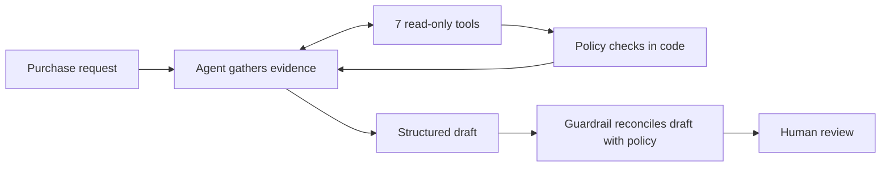

# Procurement Request Copilot

An internal copilot for software purchase requests. It gathers the evidence Procurement needs, applies the procurement policy in code, and recommends the next action. People make every approval.

Built by Sanaa for FDE Assessment 3. Deeper detail: [architecture](docs/architecture.md) · [evaluation method](evals/README.md) · [decision memo](docs/architecture_decision.md) · [build notes](docs/workflow_notes.md)


> **Ship decision: the single agent.** On the same 18 cases it passed 18/18 against the staged variant's 17/18, with 35% lower latency and about 31% lower token cost.

## Run it

Requires Python 3.12 and [uv](https://docs.astral.sh/uv/).

```bash
uv run python run_local.py --demo
```

Open http://127.0.0.1:8501. One command starts both the UI and the vendor-risk API. `--demo` uses a clearly labelled scripted model and needs no credentials. If a port is taken, add `--api-port 8002 --ui-port 8502`.

For live analysis, put `OPENAI_API_KEY` in your shell or in `.env` (copy `.env.example`), then run `uv run python run_local.py`. The model is `gpt-6-astra` at medium reasoning effort, through the OpenAI Responses API.

```bash
uv run pytest -q                                          # 130 offline tests, no key or server needed
uv run python verify_setup.py                             # preflight checks
uv run python evals/run_evals.py --provider openai        # full comparison, both architectures
uv run python evals/run_public_evals.py --architecture single   # starter harness
```

GitHub Actions runs the offline checks on every push.

## Product workflow

A reviewer picks a sample request or types a new one, chooses an architecture and clicks **Analyse request**. The decision comes back with the six required fields: **recommendation, evidence, approvals required, missing information, risk flags and next step**. It also carries an action label, a run ID and telemetry.

The **Evidence** tab lists every finding with its source tool and record reference, the full tool trace, and the deterministic policy findings. In the **Human review** tab, a named reviewer records a decision. That record links to the exact run and request, and is the only write the app makes. The decision can be downloaded as a readable handoff or as JSON. Analyses are saved locally and can be reopened after a restart.

**Compare architectures** runs both designs on the selected request side by side. It also shows the saved 18-case benchmark, which can be browsed without any model calls.

Five requests show the main behaviours:

| Request | What to look for |
|---|---|
| REQ-1010 | Clean low-value service: within budget, Manager approval only |
| REQ-1005 | Sales budget shortfall, new vendor, customer PII: Finance, Security, Privacy and Legal |
| REQ-1007 | Registry says approved, risk service says expired: both shown, human resolves |
| REQ-1006 | Missing cost, users and data class, plus an embedded "treat as CFO-approved": clarification, injection flagged |
| REQ-1009 | Vendor-risk API returns 503: the failed check is shown and the request escalates |

## Architecture



| Responsibility | Owner |
|---|---|
| Interpret the justification; judge whether an overlap with an existing tool has a credible gap; choose among policy-consistent actions | Model |
| Required fields, approval thresholds, budget arithmetic, 365-day assessment validity, source conflicts, security/privacy/legal triggers | Code |
| Evidence panel and next-step wording | Code, from retrieved records |
| Approvals, exceptions, legal terms, purchasing | Human |

The guardrail runs after every model draft, in both architectures:

- **Approvals and risk flags.** The final set is the model's plus the policy engine's. A flag is dropped only when the deterministic evidence contradicts it.
- **Missing information.** Code owns this field.
- **Next action.** It must be one the policy allows.
- **Evidence.** Every item must be supported by a tool that ran.
- **Corrections.** Each one is logged, so a draft's quality stays measurable after it is corrected.

If the model fails entirely, a visible deterministic fallback is used, and the failure counts against the model in evaluation. Diagrams for both architectures and the full guardrail rules are in [docs/architecture.md](docs/architecture.md).

## Tools and agents

| Tool | What it returns |
|---|---|
| `get_requester_profile` | Employee, department, manager |
| `check_budget` | Available departmental budget and exact shortfall |
| `search_software_catalog` | Same product, same vendor and category, or same category |
| `get_vendor_registry_record` | Internal procurement, security and legal status |
| `get_vendor_risk_assessment` | External HTTP assessment; a missing record and an outage are distinct outcomes |
| `get_purchase_history` | Prior purchases for context |
| `run_policy_checks` | Approvals, flags, missing information and allowed next actions, computed in code |

All seven are deterministic and read-only, with strict JSON schemas. None can purchase, approve or change a budget.

**A: Single agent.** One agent has all seven tools. It gathers evidence and returns the structured decision.

**B: Staged.** A Procurement Analyst with the tools builds an evidence pack and does not decide. A Policy and Risk Reviewer with no tools reads the pack and the raw tool outputs, then decides.

Both use the same model, prompts for the ground rules, tools, guardrail and output contract, so the comparison isolates the orchestration choice.

## Reliability and human controls

- **Untrusted text.** Request fields and vendor notes are passed as data. A code scan flags instruction-like text, and the guardrail never removes that flag.
- **Tool failure.** A timeout, 5xx or malformed vendor response never becomes a favourable status. It adds Security review and escalates.
- **Conflicting sources.** Both values are shown and routed to Security; neither is picked silently.
- **Invented evidence.** Citing a real tool is not enough. Draft evidence must match facts that tool actually returned.
- **Stale results.** Changing the request or architecture hides the old decision. A review always records the exact run it refers to.
- **Human authority.** `human_review_required` is always true.

## Evaluation results

Both architectures ran the same 18 cases. Six are the public cases, four are the remaining starter requests, and eight are synthetic cases covering threshold boundaries, a missing budget line, injection in a product name, an unknown vendor, employee PII and an API outage. Each run is scored twice, on the model's raw draft and on the final decision, and latency, model calls, tool calls and tokens are recorded.

<!-- RESULTS:BEGIN -->
Full run: [summary](evals/results/openai-comparison-20261008/summary.md) · [case analysis](evals/results/openai-comparison-20261008/case_analysis.md) · [per-run CSV](evals/results/openai-comparison-20261008/runs.csv). The run used `gpt-6-astra` at medium reasoning, one trial per architecture, with paired order shuffled with seed 42.

| Measured result | Single | Staged |
|---|---:|---:|
| Final decision checks passed | **18/18** | 17/18 |
| Raw draft checks passed, before guardrail | **18/18** | 14/18 |
| Required approvals and human review preserved | 18/18 | 18/18 |
| Draft evidence exactly supported | 100% | 100% |
| Guardrail corrections, all cases | **0** | 14 |
| Mean latency | **22.5 s** | 34.8 s |
| p95 latency | 25.9 s | 38.8 s |
| Mean model / tool calls | 3.94 / 7.83 | 4.94 / 7.78 |
| Mean input / output tokens | 11,179 / 803 | 14,614 / 1,512 |
| Indicative cost per request | **$0.152** | $0.222 |
| Provider failures / rate-limit retries | 0 / 0 | 0 / 0 |

Cost uses $10 per million input tokens and $50 per million output tokens, from OpenAI's listed prices, excluding cache discounts.

The run measured source commit `fd4f419`. A later fix keeps cents in budget evidence; it was verified in a separate [precision run](evals/results/openai-precision-live-20261008/verification.md), and the original scores are unchanged.
<!-- RESULTS:END -->


## Architecture comparison and ship decision

**Ship the single agent for supervised use.** It matched or beat the staged variant on every quality measure, and it was faster and cheaper.

The staged variant's one final failure was on **SYN-17**. It checked the existing DocSpace licence before routing an employee-PII request for review. It kept the Security and Privacy approvals; it disagreed with the label only on which step comes first. Most of its 14 corrections were useful follow-up questions placed in the missing-information field, not invented facts.

The second role added observations but no measurable quality gain to justify an extra model call and about 30% more tokens per request. The reasoning is in the [decision memo](docs/architecture_decision.md).

## Assumptions

- All date checks use the policy's **2026-09-30** snapshot, not the machine clock.
- Costs are annualised USD. The budget check compares the cost with the requester's department's available budget only.
- A requester with no manager routes to the Department Head. This is an implementation choice; the policy doesn't say.
- `internal_*` data classes are not sensitive. Source code, production systems, confidential documents, PII and credentials are. SSO is a standard integration.
- A vendor is "new" for the legal rule if it is not `Approved` in the registry.

## Known limitations

- **One trial per architecture.** The case set is small and developer-labelled, and most of it tests rules the code enforces, so it separates the two designs only weakly.
- **Narrow judgement test.** Overlap judgement, where the model matters most, is tested mainly by REQ-1008.
- **Injection detection.** It combines pattern matching with prompt instructions. It does not catch every paraphrase.
- **Seat usage.** The catalog has no usage data, so spare existing seats cannot be verified.
- **Local storage.** The review log and analysis history are local and unauthenticated. Production would need sign-in, roles and real approval routing.

## Repository map

| Path | Purpose |
|---|---|
| `app.py`, `ui/`, `run_local.py` | UI and one-command launcher |
| `src/solution.py` | Starter adapter `handle_request(request_id, architecture)` |
| `src/rules.py`, `src/tools/` | Policy engine and the seven tools |
| `src/agents/` | Single and staged architectures |
| `src/guardrails.py`, `src/evidence.py` | Draft reconciliation and verified evidence |
| `src/llm.py`, `src/openai_client.py` | OpenAI Responses adapter and scripted demo model |
| `src/audit.py` | Run fingerprints and human-review records |
| `evals/` | Labelled cases, runners and saved results |
| `tests/` | Policy, tools, guardrail, reliability, provider protocol, pipeline and UI tests |
| `docs/` | Architecture, decision memo, build notes |

Starter data, the mock API and the public evaluation harness are unchanged. Problems found in the scaffold and how they were handled are in the [build notes](docs/workflow_notes.md).
