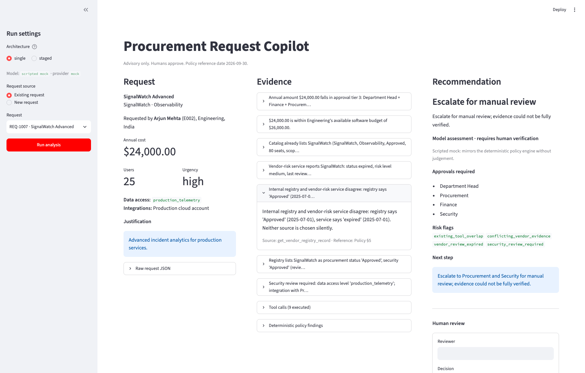
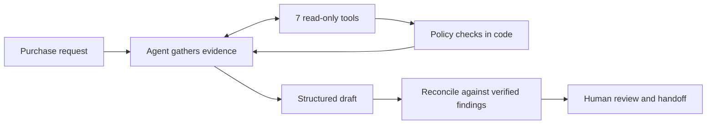

# Procurement Request Copilot

A procurement reviewer should be able to answer three questions: **What should happen next? What evidence supports it? Who must decide?** This app gathers the records, applies the policy, and produces a recommendation with a human handoff.

Built for FDE Assessment 3 by Sanaa. [Reviewer walkthrough](docs/review_guide.md) · [Architecture](docs/architecture.md) · [Evaluation](evals/README.md) · [Decision memo](docs/architecture_decision.md)



*Scripted demo: the registry and risk service disagree. The evidence panel exposes both records and the policy reference. Live model results are reported separately below.*

> **Verified locally:** 112 tests pass; the full OpenAI comparison is saved. **Ship choice: single agent.** Public repository creation and URL submission are the owner’s remaining steps.

## Try it

Install Python 3.12 and [uv](https://docs.astral.sh/uv/), then from this directory:

```bash
uv run python run_local.py --demo
```

Open **http://127.0.0.1:8501**. This command starts both the UI and the vendor-risk API. Demo mode uses a clearly labelled scripted model and needs no credentials. Ctrl+C stops both processes. If a port is occupied, choose explicit alternatives: `uv run python run_local.py --demo --api-port 8002 --ui-port 8502`.

For real model analysis:

```bash
cp .env.example .env   # only if .env does not already exist
# OPENAI_API_KEY can stay in your shell; .env is optional for credentials.
uv run python run_local.py
```

The live provider is **OpenAI only**, using `gpt-6-astra` at medium reasoning effort through the Responses API. The existing shell `OPENAI_API_KEY` takes precedence over `.env`. No provider fallback is configured. All decisions remain advisory.

## A three-minute walkthrough

1. Run **REQ-1010**: a low-value training service. Check the budget evidence and Manager approval.
2. Run **REQ-1005**: the Sales budget is insufficient and customer PII adds Security, Privacy and Legal reviews.
3. Run **REQ-1007**: the registry says approved while the risk service says expired. Both sources are shown; a human must resolve the conflict.
4. Run **REQ-1006**: missing fields and an instruction embedded in the justification. It must request clarification.
5. Run **REQ-1009**: a deliberate vendor API outage. The app exposes the failed check and escalates.
6. Record a review and download the decision. The local record includes the exact decision, run ID and request fingerprint. Sending it to approvers is a human step.

## How it works



Every response includes the six required fields: **recommendation, evidence, approvals required, missing information, risk flags and next step**. It also includes an action label, a unique run ID and telemetry.

| Responsibility | Owner |
|---|---|
| Interpret the business justification; assess whether catalog overlap has a credible gap | Model, subject to human verification |
| Approval thresholds, budget arithmetic, assessment dates, conflicts and required reviews | Code |
| Factual evidence panel and operational next-step wording | Code, generated from retrieved records and policy findings |
| Approvals, exceptions, accepting terms and purchasing | Human |

The model chooses among policy-consistent actions. Its interpretation is labelled separately from verified facts. The guardrail runs even if the agent omits a tool or fails entirely; fallback is visible and counts as a model failure in evaluation.

## The architecture experiment

**A — Single agent:** one agent gathers evidence and recommends an action.

**B — Staged:** an analyst gathers evidence and assesses overlap; a reviewer receives the pack and raw tool outputs, then recommends an action. Only the analyst has tools.

Both use the same OpenAI model, policy, tools, case set and final guardrail. Function calls and final outputs use strict JSON schemas, with local validation. No extra critic or orchestration framework is needed.

| Tool | Evidence / calculation |
|---|---|
| `get_requester_profile` | Employee, department and manager |
| `check_budget` | Available departmental budget and exact shortfall |
| `search_software_catalog` | Existing products, vendor/category overlap and scope |
| `get_vendor_registry_record` | Internal procurement, security and legal statuses |
| `get_vendor_risk_assessment` | External HTTP assessment; typed missing-record/outage outcomes |
| `get_purchase_history` | Prior purchases for context |
| `run_policy_checks` | Policy findings, verified facts and allowed next actions |

All seven tools are deterministic. Inputs are validated locally; results are cached within each request. The model has no purchasing or budget-write tool.

## Reliability that can be tested

- **Invented evidence:** naming an existing tool is insufficient. The factual panel is generated from code-verified findings. Raw-draft grounding checks exact facts available to the agent before the final guardrail.
- **Unsafe wording:** a valid action label cannot carry “skip Security” in its next step. Recommendation and handoff wording come from the validated action.
- **Incomplete evidence:** timeouts, malformed vendor responses, missing/future assessment dates and failed local lookups cannot become favourable statuses.
- **Model failures:** invalid output schemas, refusals, provider failures and exhausted tool loops produce a visible deterministic fallback. Failed attempts count in telemetry.
- **Human review:** changing the request or architecture hides stale decisions. Review records reference the exact run; repeated identical submissions are deduplicated.
- **Repeatability:** tests exercise the actual FastAPI routes in-process. They need neither a listening API nor model credentials.

```bash
uv sync --frozen --extra dev
uv run pytest -q
uv run python verify_setup.py
uv run python evals/run_evals.py --provider mock
```

GitHub Actions runs the same offline checks. The [starter-pack audit](docs/starter_audit.md) verifies preserved files by SHA-256 and confirms the original output schema is unchanged. The untouched reference copy is kept locally; completed implementation is at the repository root.

## Evaluation and ship decision

The 18 cases cover public requirements, all remaining starter requests, financial boundaries, missing budget data, prompt injection, unknown vendors, employee PII and API outages.

The comparison records final policy correctness **and** raw-draft correctness, exact evidence support, guardrail corrections, model failures, latency, tool/model calls and tokens. Case/architecture order is paired and shuffled with a recorded seed. Every trial is saved immediately, including failures; source hashes and configuration make the experiment traceable.

```bash
# Verify live access with a small case first; no separate API server needed.
uv run python evals/run_evals.py --provider openai --case-id EXT-10
# Then compare both architectures on the full same test set.
uv run python evals/run_evals.py --provider openai --repeats 1
```

The API is billed to the account owning `OPENAI_API_KEY`. Each run records tokens and accepts explicit price inputs for a reproducible estimate. Provider failures and time spent waiting for rate limits remain visible in the report.

<!-- RESULTS:BEGIN -->
**Ship the single agent for supervised use.** In the [complete OpenAI experiment](evals/results/openai-comparison-20261008/summary.md), 18 cases were run once per architecture with `gpt-6-astra`, medium reasoning, paired order and seed 42.

| Measured result | Single | Staged |
|---|---:|---:|
| Final end-to-end checks passed | **18/18** | 17/18 |
| Raw-draft checks passed | **18/18** | 14/18 |
| Required approvals and human review preserved | 18/18 | 18/18 |
| Draft evidence exactly supported | 100% | 100% |
| Field corrections across all requests | **0** | 14 |
| Mean latency | **22.5 s** | 34.8 s |
| Observed p95 latency | 25.9 s | 38.8 s |
| Mean model / tool calls | 3.94 / 7.83 | 4.94 / 7.78 |
| Mean input / output tokens | 11,179 / 803 | 14,614 / 1,512 |
| Indicative token cost per request | **$0.152** | $0.222 |
| Provider failures / rate-limit retries | 0 / 0 | 0 / 0 |

Single used 35% less time and approximately 31% less estimated token cost. The staged final failure is a strict sequencing disagreement on **SYN-17**, with Security and Privacy approvals retained. Its other raw failures concern follow-up questions placed in the missing-information field. These are narrower findings than a safety failure; see the [case analysis](evals/results/openai-comparison-20261008/case_analysis.md) and [decision memo](docs/architecture_decision.md).

Prices supplied to the runner were $10 per million input tokens and $50 per million output tokens, from the [OpenAI model documentation](https://developers.openai.com/api/docs/models/gpt-6-astra). The estimate excludes cache discounts and is not an invoice. One repeat on a small, mostly policy-driven case set does not establish production reliability or a statistically significant quality difference.

The comparison measures source commit `0de3dc7`. Reviewing it exposed rounded budget prose; the current code preserves cents, verified separately in the [precision follow-up](evals/results/openai-precision-live-20261008/summary.md). Original trials and scores are unchanged. The [experiment index](evals/results/README.md) distinguishes the main comparison, follow-up and integration pilots.
<!-- RESULTS:END -->

## Assumptions and limits

- All date checks use the assignment's **2026-09-30** policy snapshot, not the machine clock. The assessment expires at the end of its 365-day validity interval.
- Costs are annualised USD. Available budget is a snapshot, not a reservation; concurrent requests can still compete for the same funds.
- A requester without a manager routes to the Department Head. This is an explicit implementation assumption, not a quoted policy rule.
- Catalog data has no utilisation or detailed feature entitlements. The model may assess a claimed gap but cannot verify spare seats or vendor capabilities.
- Exact evidence copying is intentionally stricter than semantic entailment: a correct paraphrase can score as unsupported. Model rationale is not automatically fact-checked.
- Injection detection is pattern-based plus prompt instructions; it is not a general injection-proofing claim.
- The review log is local and unauthenticated. It is not a production approval system or a tamper-proof audit ledger.
- The case set is small and developer-authored. Repeats measure consistency, not independent sample size. Provider throttling can dominate latency.

## Repository map

| Path | Purpose |
|---|---|
| `app.py`, `run_local.py` | Product and one-command launcher |
| `src/solution.py` | Starter-compatible `handle_request(request_id, architecture)` |
| `src/rules.py`, `src/tools/` | Policy and seven tools |
| `src/agents/` | Single and staged architectures |
| `src/guardrails.py`, `src/evidence.py` | Validated action and factual evidence boundary |
| `src/llm.py`, `src/openai_client.py` | OpenAI Responses adapter and offline test fixture |
| `src/audit.py` | Request fingerprints and local human-review records |
| `evals/` | Labelled cases, runner, complete and partial experiment artifacts |
| `tests/` | Policy, adversarial output, provider protocol, pipeline and UI checks |
| `docs/` | Architecture, reviewer walkthrough, decision memo and workflow notes |

The [workflow notes](docs/workflow_notes.md) explain starter issues and subsequent reliability fixes.
