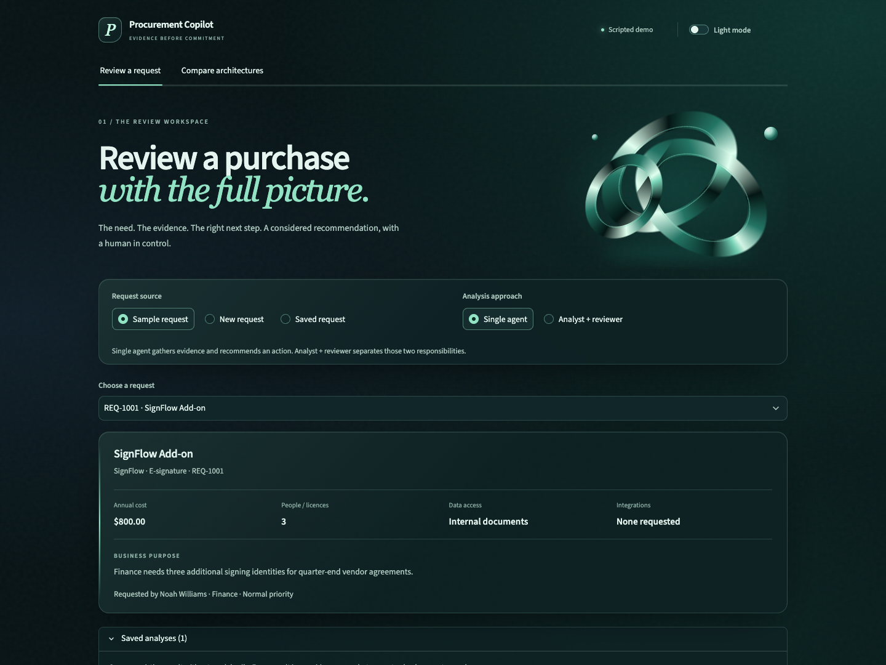
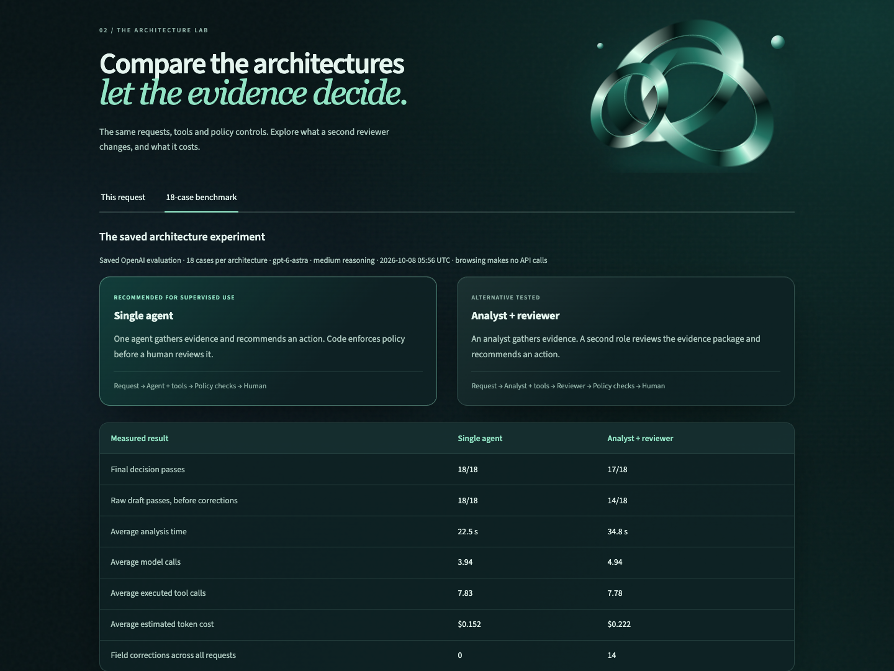
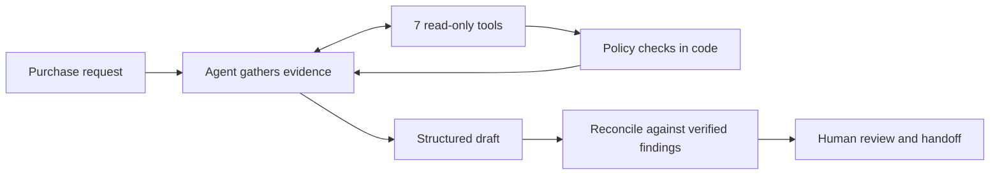

# Procurement Request Copilot

A procurement reviewer should be able to answer three questions: **What should happen next? What evidence supports it? Who must decide?** This app gathers the records, applies the policy, and produces a recommendation with a human handoff.

Built for FDE Assessment 3 by Sanaa. [Requirement coverage](#assessment-requirement-coverage) · [Engineering decisions](#engineering-decisions-and-tradeoffs) · [Reviewer walkthrough](docs/review_guide.md) · [Architecture](docs/architecture.md) · [Evaluation](evals/README.md) · [Decision memo](docs/architecture_decision.md)



*Scripted demo workspace. The Light mode switch changes to a [soft mint theme](docs/images/review-workspace-light.png). Both appearances use the same review workflow.*



*The benchmark view reads the saved live experiment. The separate **This request** view compares the request currently selected in the workspace. Browsing saved results makes no model calls.*

[View a request-specific comparison](docs/images/request-comparison-light.png) — a labelled scripted demonstration of the two-result workflow, separate from the live benchmark above.

> **Verified locally:** 132 tests pass; the full OpenAI comparison is saved. **Ship choice: single agent.** Pushing the repository, checking public access and submitting its URL remain the owner’s steps.

## Try it

Install Python 3.12 and [uv](https://docs.astral.sh/uv/), then from this directory:

```bash
uv run python run_local.py --demo
```

Open **http://127.0.0.1:8501**. This command starts both the UI and the vendor-risk API. Demo mode uses a clearly labelled scripted model and needs no credentials. Ctrl+C stops both processes. If a port is occupied, choose explicit alternatives: `uv run python run_local.py --demo --api-port 8002 --ui-port 8502`.

For real model analysis:

```bash
cp .env.example .env   # only if .env does not already exist
# OPENAI_API_KEY can stay in your shell; .env is optional for credentials.
uv run python run_local.py
```

The live provider is **OpenAI only**, using `gpt-6-astra` at medium reasoning effort through the Responses API. The existing shell `OPENAI_API_KEY` takes precedence over `.env`. No provider fallback is configured. All decisions remain advisory.

## A three-minute walkthrough

1. Run **REQ-1010**: a low-value training service. Check the budget evidence and Manager approval.
2. Run **REQ-1005**: the Sales budget is insufficient and customer PII adds Security, Privacy and Legal reviews.
3. Run **REQ-1007**: the registry says approved while the risk service says expired. Both sources are shown; a human must resolve the conflict.
4. Run **REQ-1006**: missing fields and an instruction embedded in the justification. It must request clarification.
5. Run **REQ-1009**: a deliberate vendor API outage. The app exposes the failed check and escalates.
6. Open **Human review**, enter a name and save a review. Download the readable handoff or decision JSON. The local record includes the exact decision, run ID and request fingerprint; sending it to approvers is a human step.
7. Open **Compare architectures → This request**. The existing result is reused; click the comparison button to run only the missing architecture. Compare actions, approvals, risk flags, evidence, corrections, latency and token usage. A complete pair can be downloaded.
8. Open **18-case benchmark** to inspect the measured ship decision and the SYN-17 disagreement. This fixed experiment is separate from exploratory requests; browsing its scores, CSV and memo makes no calls.
9. Return to a sample and open **Saved analyses → View saved analysis**, or use **Saved request** to reopen a custom request after restarting the app. **Analyse again** produces a new run and keeps the original.

## How it works



**Review a request** has a full-width intake and decision flow. After analysis, request details collapse and the next step is prominent. Evidence, human review and diagnostics have their own tabs. The app hides Streamlit’s developer toolbar and deployment prompt; its visible controls are specific to the review workflow.

The header's **Light mode** switch preserves the current request and analysis. The selected appearance survives a refresh of the same URL. Decorative gradients and reflective forms are generated with CSS; no image service, external asset host or model call is involved. Reduced-motion preferences disable the subtle decorative movement.

Selecting or editing a request does not call the model. **Analyse request** starts a run, and **Analyse again** explicitly starts a fresh one. Changing request content or approach invalidates the displayed result. Downloads, review saves and comparison browsing never rerun the agent; the comparison run button is an explicit, billable action in live mode.

Every completed app analysis is stored in ignored `logs/analyses.sqlite3`, including the request, exact result, trace, time and configuration identity. History survives browser and process restarts. Matching sample results from the original experiment are also available as labelled, read-only historical snapshots. Results are never silently substituted for fresh evidence. Older policy/data/model configurations can be inspected and downloaded but cannot record a new review until rerun. External vendor state can still change; each saved result displays its original time.

New requests accept a typed name. An exact, unique directory match supplies the verified department and manager; an optional employee ID resolves duplicate names. An unknown name is accepted, preserved and routed for identity clarification. A typed department cannot create an employee record, prove identity or grant access to another team's budget. These lookups are not authentication.

Every response includes the six required fields: **recommendation, evidence, approvals required, missing information, risk flags and next step**. It also includes an action label, a unique run ID and telemetry.

| Responsibility | Owner |
|---|---|
| Interpret the business justification; assess whether catalog overlap has a credible gap | Model, subject to human verification |
| Approval thresholds, budget arithmetic, assessment dates, conflicts and required reviews | Code |
| Factual evidence panel and operational next-step wording | Code, generated from retrieved records and policy findings |
| Approvals, exceptions, accepting terms and purchasing | Human |

The model chooses among policy-consistent actions. Its interpretation is labelled separately from verified facts. The guardrail runs even if the agent omits a tool or fails entirely; fallback is visible and counts as a model failure in evaluation.

## The architecture experiment

**A — Single agent:** one agent gathers evidence and recommends an action.

**B — Staged:** an analyst gathers evidence and assesses overlap; a reviewer receives the pack and raw tool outputs, then recommends an action. Only the analyst has tools.

Both use the same OpenAI model, policy, tools, case set and final guardrail. Function calls and final outputs use strict JSON schemas, with local validation. No extra critic or orchestration framework is needed.

| Tool | Evidence / calculation |
|---|---|
| `get_requester_profile` | Employee, department and manager |
| `check_budget` | Available departmental budget and exact shortfall |
| `search_software_catalog` | Existing products, vendor/category overlap and scope |
| `get_vendor_registry_record` | Internal procurement, security and legal statuses |
| `get_vendor_risk_assessment` | External HTTP assessment; typed missing-record/outage outcomes |
| `get_purchase_history` | Prior purchases for context |
| `run_policy_checks` | Policy findings, verified facts and allowed next actions |

All seven tools are deterministic. Inputs are validated locally; results are cached within each request. The model has no purchasing or budget-write tool.

## Reliability that can be tested

- **Invented evidence:** naming an existing tool is insufficient. The factual panel is generated from code-verified findings. Raw-draft grounding checks exact facts available to the agent before the final guardrail.
- **Unsafe wording:** a valid action label cannot carry “skip Security” in its next step. Recommendation and handoff wording come from the validated action.
- **Incomplete evidence:** timeouts, malformed vendor responses, missing/future assessment dates and failed local lookups cannot become favourable statuses.
- **Model failures:** invalid output schemas, refusals, provider failures and exhausted tool loops produce a visible deterministic fallback. Failed attempts count in telemetry.
- **Human review:** changing the request or architecture hides stale decisions. Review records reference the exact run; repeated identical submissions are deduplicated.
- **Repeatability:** tests exercise the actual FastAPI routes in-process. They need neither a listening API nor model credentials.

```bash
uv sync --frozen --extra dev
uv run python -m pytest -q
uv run python verify_setup.py
uv run python evals/run_evals.py --provider mock
```

GitHub Actions runs the same offline checks. The [starter-pack audit](docs/starter_audit.md) verifies preserved files by SHA-256 and confirms the original output schema is unchanged. The untouched reference copy is kept locally; completed implementation is at the repository root.

## Evaluation and ship decision

The 18 cases cover public requirements, all remaining starter requests, financial boundaries, missing budget data, prompt injection, unknown vendors, employee PII and API outages.

The comparison records final policy correctness **and** raw-draft correctness, exact evidence support, guardrail corrections, model failures, latency, tool/model calls and tokens. Case/architecture order is paired and shuffled with a recorded seed. Every trial is saved immediately, including failures; source hashes and configuration make the experiment traceable.

```bash
# Verify live access with a small case first; no separate API server needed.
uv run python evals/run_evals.py --provider openai --case-id EXT-10
# Then compare both architectures on the full same test set.
uv run python evals/run_evals.py --provider openai --repeats 1
```

The API is billed to the account owning `OPENAI_API_KEY`. Each run records tokens and accepts explicit price inputs for a reproducible estimate. Provider failures and time spent waiting for rate limits remain visible in the report.

<!-- RESULTS:BEGIN -->
**Ship the single agent for supervised use.** In the [complete OpenAI experiment](evals/results/openai-comparison-20261008/summary.md), 18 cases were run once per architecture with `gpt-6-astra`, medium reasoning, paired order and seed 42.

| Measured result | Single | Staged |
|---|---:|---:|
| Final end-to-end checks passed | **18/18** | 17/18 |
| Raw-draft checks passed | **18/18** | 14/18 |
| Required approvals and human review preserved | 18/18 | 18/18 |
| Draft evidence exactly supported | 100% | 100% |
| Field corrections across all requests | **0** | 14 |
| Mean latency | **22.5 s** | 34.8 s |
| Observed p95 latency | 25.9 s | 38.8 s |
| Mean model / tool calls | 3.94 / 7.83 | 4.94 / 7.78 |
| Mean input / output tokens | 11,179 / 803 | 14,614 / 1,512 |
| Indicative token cost per request | **$0.152** | $0.222 |
| Provider failures / rate-limit retries | 0 / 0 | 0 / 0 |

Single used 35% less time and approximately 31% less estimated token cost. The staged final failure is a strict sequencing disagreement on **SYN-17**, with Security and Privacy approvals retained. Its other raw failures concern follow-up questions placed in the missing-information field. These are narrower findings than a safety failure; see the [case analysis](evals/results/openai-comparison-20261008/case_analysis.md) and [decision memo](docs/architecture_decision.md).

Prices supplied to the runner were $10 per million input tokens and $50 per million output tokens, from the [OpenAI model documentation](https://developers.openai.com/api/docs/models/gpt-6-astra). The estimate excludes cache discounts and is not an invoice. One repeat on a small, mostly policy-driven case set does not establish production reliability or a statistically significant quality difference.

The comparison measures source commit `0de3dc7`. Reviewing it exposed rounded budget prose; the current code preserves cents, verified separately in the [precision follow-up](evals/results/openai-precision-live-20261008/summary.md). Original trials and scores are unchanged. The [experiment index](evals/results/README.md) distinguishes the main comparison, follow-up and integration pilots.
<!-- RESULTS:END -->

## Assessment requirement coverage

Checked against the final supplied **FDE_Assessment_3.pdf**, including its public-repository and README requirements. The [starter audit](docs/starter_audit.md) verifies the supplied data, mock service, public harness and original output contract were preserved.

| Brief requirement | Implementation and reviewable evidence |
|---|---|
| Product UI: request, evidence, recommendation and action | [Review workspace](ui/review.py), full source references, local human review, Markdown/JSON handoff; [interaction tests](tests/test_ui.py) |
| At least 3 tools, including a deterministic tool | [7 schema-validated tools](src/tools/__init__.py); thresholds, budget and assessment validity are code-owned |
| Working single-agent baseline | [Single agent](src/agents/single.py), starter-compatible [adapter](src/solution.py), saved real model trials |
| Structured output with all six required fields | [Original contract plus compatible extension](src/contracts.py): recommendation, evidence, required approvals, missing information, risk flags, next step |
| Human handoff; sensitive approvals stay with people | [Guardrail](src/guardrails.py), advisory next-step templates, human-review log tied to the exact run; no purchasing or approval-write tool |
| Lightweight staged / two-agent comparison | [Analyst → reviewer](src/agents/staged.py), same model, reasoning setting, tools, guardrail and 18-case test set |
| Evaluate action, grounding, policy, escalation, latency and calls | [Reproducible evaluator](evals/run_evals.py), [metric definitions](evals/README.md), [CSV](evals/results/openai-comparison-20261008/runs.csv), drafts and traces |
| All six edge-case families in the brief | Incomplete inputs, overlap, expired/conflicting vendors, sensitive data/thresholds, injected instructions and unavailable tools: [labelled cases](evals/cases.json), policy/guardrail/pipeline tests |
| One-command local app | `uv run python run_local.py --demo` starts UI and supplied vendor API without credentials; the same launcher supports live OpenAI |
| Architecture / workflow diagram and assumptions | Workflow above; [both architecture diagrams and boundaries](docs/architecture.md); explicit assumptions and limits below |
| Architecture decision memo, maximum 500 words | [Results-backed memo](docs/architecture_decision.md): ship single for supervised use, explain the staged miss and evidence limits |
| Clear README, setup and secret hygiene | This README, locked dependencies, offline CI, `.env.example`; credentials and runtime history/reviews excluded from Git |
| Public GitHub URL submitted through the form | Owner action: verify signed-out access and submit the repository URL; local completeness does not prove submission |

The scoring weights are product/workflow **15%**, end-to-end product **20%**, agent/tool design **20%**, reliability/human controls **15%**, evaluation/comparison **20%**, and engineering/communication **10%**. The evidence above supports those categories; it does not imply a guaranteed score.

## Engineering decisions and tradeoffs

| Decision | Reason and consequence |
|---|---|
| Build on the supplied scaffold | Preserves the evaluator contract and source data. Fixes are documented and regression-tested instead of changing inconvenient fixtures. |
| Code owns policy; the model chooses within valid actions | Exact thresholds and mandatory reviews need repeatability. Business-context interpretation still matters, but model prose cannot bypass a required review. |
| Keep factual evidence separate from model interpretation | A plausible source name is insufficient grounding. Facts come from verified tool findings; free-form rationale stays labelled for human verification. |
| Ship the single agent for a supervised pilot | The measured baseline matched or outperformed staged on this set with fewer calls and lower latency. Two roles remain available for investigation, not as an unsupported quality claim. |
| Preserve raw and corrected outputs, including failures | A guardrail can hide model mistakes. Separate scores reveal that effect; failed provider attempts remain visible rather than becoming successful policy fallbacks. |
| Separate the fixed benchmark from request comparison | The benchmark has labels and supports the ship decision. An ad-hoc pair shows differences and resource usage, but agreement is not a correctness score and is never pooled into benchmark accuracy. |
| Store immutable run snapshots in SQLite | Survives reloads, supports concurrent local writes and needs no extra service. Full input/configuration identity prevents accidental reuse across changed requests; it remains a local, unauthenticated store. |
| Reuse a matching run only as an explicit snapshot | Avoids paying repeatedly to inspect a result. Refreshing evidence is a distinct action; no cache key can prove an external vendor's state has stayed unchanged. |
| Accept arbitrary names without inventing organisational authority | Makes intake usable while retaining the distinction between a supplied name and a verified directory record. Unknown or ambiguous requesters get clarification, not an assumed budget. |
| Persist each comparison result separately | A failed second architecture does not discard or rerun the successful first. Retries target the missing design, limiting unnecessary calls. |
| Prefer a one-command local vertical slice | The assignment needs a working local product. Authentication, real approval routing and managed storage are explicit rollout requirements, not fake buttons in the demo. |

The [workflow notes](docs/workflow_notes.md) record discovered failures and fixes. The [architecture document](docs/architecture.md) explains control/data boundaries, and the [evaluation guide](evals/README.md) defines the measurements and reproducibility controls.

## Assumptions and limits

- All date checks use the assignment's **2026-09-30** policy snapshot, not the machine clock. The assessment expires at the end of its 365-day validity interval.
- Costs are annualised USD. Available budget is a snapshot, not a reservation; concurrent requests can still compete for the same funds.
- A requester without a manager routes to the Department Head. This is an explicit implementation assumption, not a quoted policy rule.
- Catalog data has no utilisation or detailed feature entitlements. The model may assess a claimed gap but cannot verify spare seats or vendor capabilities.
- Exact evidence copying is intentionally stricter than semantic entailment: a correct paraphrase can score as unsupported. Model rationale is not automatically fact-checked.
- Injection detection is pattern-based plus prompt instructions; it is not a general injection-proofing claim.
- The review log is local and unauthenticated. It is not a production approval system or a tamper-proof audit ledger.
- Analysis history is shared by sessions using the same local database. It contains request data and must stay out of a public repository. Production use needs authentication, per-user access, retention rules and managed backup; none is implied by the local prototype.
- The case set is small and developer-authored. Repeats measure consistency, not independent sample size. Provider throttling can dominate latency.

## Repository map

| Path | Purpose |
|---|---|
| `app.py`, `ui/`, `run_local.py` | Product entry point, presentation and one-command launcher |
| `src/solution.py` | Starter-compatible `handle_request(request_id, architecture)` |
| `src/rules.py`, `src/tools/` | Policy and seven tools |
| `src/agents/` | Single and staged architectures |
| `src/guardrails.py`, `src/evidence.py` | Validated action and factual evidence boundary |
| `src/llm.py`, `src/openai_client.py` | OpenAI Responses adapter and offline test fixture |
| `src/audit.py` | Request fingerprints and local human-review records |
| `ui/history.py`, `ui/runs.py`, `ui/intake.py` | Durable analysis snapshots, explicit run/reuse coordination and typed-name resolution |
| `evals/` | Labelled cases, runner, complete and partial experiment artifacts |
| `tests/` | Policy, adversarial output, provider protocol, pipeline and UI checks |
| `docs/` | Architecture, reviewer walkthrough, decision memo and workflow notes |

The [workflow notes](docs/workflow_notes.md) explain starter issues and subsequent reliability fixes.
