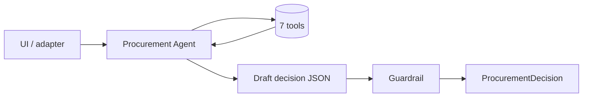
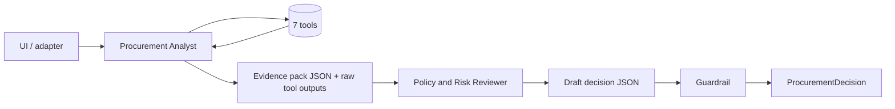

# Architecture and workflow

## Workflow

```mermaid
flowchart LR
    R[Employee request] --> U[Understand need]
    U --> G[Gather evidence]
    subgraph tools [Tools]
        T1[get_requester_profile]
        T2[check_budget]
        T3[search_software_catalog]
        T4[get_vendor_registry_record]
        T5[get_vendor_risk_assessment]
        T6[get_purchase_history]
        T7[run_policy_checks]
    end
    G --> tools
    tools --> D[Deterministic policy engine]
    D --> M[Model draft: recommendation, rationale, next action]
    M --> GR[Guardrail: reconcile draft with engine]
    GR --> H[Human review and approval]
```



The policy engine runs twice: once if the agent calls `run_policy_checks` (so the model can read the binding minimums) and always once more in code after the agent finishes. Tool results are cached per run, so the second pass reuses what the agent already fetched and counts no extra tool calls.

## Architecture A: single agent



One model with all seven tools in a tool-use loop (at most 8 iterations). It gathers evidence, calls the policy engine, and writes the decision in one structured output. Typical cost: 2 to 4 model calls.

## Architecture B: staged, two roles



The analyst is the only role with tools and is told not to decide. It hands over a structured evidence pack (facts with sources, uncertainties, an overlap assessment, untrusted-text observations). The reviewer has no tools; it receives the request, the pack and the raw tool outputs, and writes the decision. Typical cost: analyst 2 to 4 calls plus 1 reviewer call.

Both architectures share the same tools, policy engine, guardrail, output contract and prompts for the ground rules, so the comparison isolates the orchestration choice.

## Division of responsibility

| Concern | Owner | Where |
|---|---|---|
| Required fields (policy §1) | Code | `src/rules.py` `check_required_fields` |
| Budget arithmetic and shortfall (§2) | Code | `src/tools/budget.py`, `rules.evaluate` |
| Catalog overlap detection (§3) | Code finds matches; model judges whether the gap is credible | `src/tools/catalog.py`, prompts |
| Approval thresholds (§4) | Code, `Decimal` boundaries | `rules.approval_tier` |
| Assessment freshness, 365 days from the policy reference date (§5) | Code | `rules.evaluate` |
| Registry vs. vendor-risk service conflict (§5) | Code surfaces; human resolves | `rules.evaluate` |
| Security / privacy / legal triggers (§5 to §7) | Code | `rules.evaluate` |
| Untrusted text / prompt injection (§9) | Code scan plus model instruction; either can raise the flag, neither can lower it | `rules.scan_untrusted_text`, `common.GROUND_RULES` |
| Tool failure handling (§10) | Code: outage is `vendor_risk_unavailable`; a missing record is "assessment not completed" | `src/tools/vendor.py`, `rules.evaluate` |
| Recommendation wording, rationale, next step, request summary | Model, within the engine's allowed next actions | `src/agents/*` |
| Final authority (§11) | Human; `human_review_required` is always true and the UI only records a human decision | `src/guardrails.py`, `app.py` |

## Guardrail rules

Applied to every model draft, in both architectures (`src/guardrails.py`):

1. `required_approvals` = canonicalised model approvals ∪ engine approvals. Unrecognised names are dropped and logged.
2. `risk_flags` = canonicalised model flags ∪ engine flags, minus flags the deterministic evidence contradicts (for example `budget_insufficient` when the budget check passed).
3. `missing_information` is code-owned; policy §1 is an explicit list.
4. `next_action` must be in the engine's allowed set, otherwise it is replaced by the engine's preferred action and the next step is regenerated.
5. Every evidence item must cite a tool that ran in this request; others are dropped. The engine's own evidence items are appended.
6. `human_review_required` is always true.

Every correction is recorded in `telemetry.guardrail_corrections`, which is how the evaluation measures the quality of each architecture's raw draft.

## Handoff format

Staged variant, analyst to reviewer:

```json
{
  "request_summary": "…",
  "facts": [{"source": "check_budget", "finding": "…", "reference": "department_budgets.csv:Sales"}],
  "uncertainties": ["…"],
  "overlap_assessment": "…",
  "untrusted_text_observations": "…"
}
```

plus the raw tool outputs as a JSON list. Both architectures emit the same final `CopilotDecision` (a `ProcurementDecision` with `next_action`, `rationale`, `request_summary` and extended telemetry added).

## Stop and escalation conditions

| Condition | Result |
|---|---|
| Any required field missing or unusable | `request_clarification`; approvals stay partial; nothing is invented |
| Vendor-risk service unreachable, 5xx or timeout | `vendor_risk_unavailable`, Security review, `escalate_manual_review` |
| Registry and service disagree on status or dates | `conflicting_vendor_evidence`, Security review, `escalate_manual_review` |
| Cost above available budget or no budget line | Finance added, `budget_exception_required` |
| Model unavailable, refuses, or returns non-JSON | Decision built from the deterministic findings only; the error is in the trace and the UI shows it |
| Agent exceeds 8 tool iterations | One final no-tools turn is requested; if still no JSON, deterministic fallback |

## Assumptions

- The policy reference date (2026-09-30) is the "today" for every date check; it is parsed from `data/procurement_policy.md`.
- Annual cost is already annualised; no proration or multi-year handling.
- "Within budget" compares against `available_usd` for the requester's department only; cross-department funding is a Finance decision.
- `internal_documents` and `internal_marketing` are not sensitive data classes; `confidential_documents`, `source_code`, `production_*`, `*_pii` and credentials are.
- SSO is treated as a standard integration, not a security trigger; production, cloud-account, repository, database and credential integrations are.
- A vendor-level `processes_personal_data=true` does not by itself trigger Privacy review; the request's data-access level does, as does cross-region storage of sensitive data.
- "New vendor" (policy §7) means not `Approved` in the internal registry, or absent from it.
- Overlap with the same vendor in the same category is an expansion; whether it is a legitimate add-on or a duplicate is a judgement left to the model (and ultimately the human), with the conservative default being to check existing capacity when the existing agreement already covers the requesting department.
- `Go To Market` (employee E007's department) has no budget line in the starter data; it is handled as "budget unverifiable" rather than patched in the data.

## Not built, on purpose

- No automatic approval, purchase order creation or budget mutation anywhere in the code paths.
- No retrieval over policy text; the policy is short and is passed whole to the model, and every rule that matters is also in code.
- No third agent, no planner, no critic loop. The evaluation shows where the second role does and does not earn its cost.
- No fuzzy matching of employees or vendors beyond case-insensitive equality; an unknown ID is reported as missing information, not guessed.
